# swift-railroad-diagrams

Railroad (syntax) diagrams as SVG, in pure Swift. No dependencies; runs on every
Apple platform and on Linux.

This is a Swift port of the Rust [`railroad`](https://github.com/lukaslueg/railroad)
crate (0.3.12) and its small text format,
[`railroad_dsl`](https://github.com/lukaslueg/railroad_dsl), both by Lukas Lueg.
The output is byte-for-byte identical to the Rust crate. The test suite checks
that against SVGs the Rust crate produced.

It started as the renderer behind the regex visualizer in
[iTerm2](https://github.com/gnachman/iTerm2/pull/838).

## Installation

```swift
.package(url: "https://github.com/veridit/swift-railroad-diagrams.git", from: "0.1.0")
```

Then depend on the `Railroad` product (and `RailroadImage` for PNG export).

## Usage

```swift
import Railroad

// From the text format:
let svg = try RailroadDSL.svg(#"["SELECT" <'column', "*"> "FROM" 'table']"#,
                              css: RailroadStylesheet.light.css)

// Or build the tree yourself:
let diagram = RailroadDiagram(
    root: RailroadSequence(children: [
        RailroadSimpleStart(),
        RailroadTerminal(label: "SELECT"),
        RailroadChoice(children: [RailroadNonTerminal(label: "column"),
                                  RailroadTerminal(label: "*")]),
        RailroadSimpleEnd(),
    ]),
    css: RailroadStylesheet.dark.css)
print(diagram.svg)
```

## The text format

| Syntax | Meaning |
|---|---|
| `"if"` | terminal (literal token) |
| `'expr'` | non-terminal (named rule) |
| `` `note` `` | comment |
| `!` | empty |
| `[a b c]` | sequence |
| `{a, b, c}` | stack (a sequence wrapped over rows) |
| `<a, b, c>` | choice |
| `a?` | optional |
| `a*b` | repeat `a`, with `b` between repetitions |
| `a#b` | `a` in a box labeled `b` |

Several top-level expressions are stacked as separate diagrams. Backslash escapes
the quote character inside a literal.

## Nodes

Terminal, NonTerminal, Comment, Empty, Sequence, Stack, Choice, MultiChoice,
Subsequence, Optional, Repeat, LabeledBox, Annotation, Link, Alignment, Scale,
VerticalGrid, HorizontalGrid, Start/End, SimpleStart/SimpleEnd, and the
continuation markers.

## Visual guide

<!-- guide:begin -->
<!-- Generated by scripts/readme-guide.py from VocabularyTests.swift. Do not edit by hand. -->

Every picture below is a reference SVG from the Rust crate. The code under it is the
test that renders that SVG byte for byte, so what you see is what the code produces.
`t`, `nt` and `c` are shorthands for `RailroadTerminal(label:)`,
`RailroadNonTerminal(label:)` and `RailroadComment(text:)`. Most diagrams are drawn
between `RailroadSimpleStart()` and `RailroadSimpleEnd()`, as the crate's README does.

### Tokens

#### `terminal`


Consume exactly the token `if`.

```swift
let node = t("if")
```

#### `nonterminal`

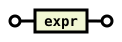

Expand the named rule `expr`.

```swift
let node = nt("expr")
```

#### `comment`


Show explanatory text along the path, without consuming a token.

```swift
let node = c("an expression follows")
```

#### `link`


Link a node to documentation. Open the SVG directly or embed it inline to use the link.

```swift
let node = RailroadLink(inner: nt("expr"),
    uri: "https://docs.rs/railroad/latest/railroad/struct.NonTerminal.html")
```

### Sequences and choices

#### `sequence`


Consume `(`, an expression, and `)` in order.

```swift
let node = RailroadSequence(children: [t("("), nt("expr"), t(")")])
```

#### `stack`

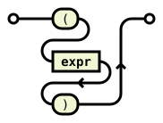

Read the same `(`, expression, `)` sequence across connected rows.

```swift
let node = RailroadStack(children: [t("("), nt("expr"), t(")")])
```

#### `choice`

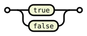

Choose exactly one alternative: `true` or `false`.

```swift
let node = RailroadChoice(children: [t("true"), t("false")])
```

#### `multi-choice`

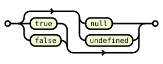

Choose one of four alternatives spread across two columns: `true`, `false`, `null`, or `undefined`.

```swift
let node = RailroadMultiChoice(columns: [
    [t("true"), t("false")], [t("null"), t("undefined")]
])
```

#### `empty`

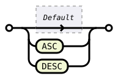

Use `Empty` where a node is required but no input is consumed. The first alternative contains a label but no token.

```swift
let node = RailroadChoice(children: [
    RailroadLabeledBox(inner: RailroadEmpty(), label: c("Default")),
    t("ASC"), t("DESC")
])
```

#### `subsequence`

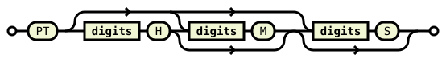

A simplified XML Schema-style duration: `PT` followed by one or more hours (`H`), minutes (`M`), and seconds (`S`), in order. Here, `digits` means one or more decimal digits. Accepts `PT1H`, `PT1H3S`, and `PT1H2M3S`; rejects `PT` and `PT3S1H`.

```swift
let parts = ["H", "M", "S"].map { unit in
    RailroadSequence(children: [nt("digits"), t(unit)])
}
let node = RailroadSequence(children: [
    t("PT"), RailroadSubsequence(children: parts)
])
```

### Repetition

#### `optional`


Consume `else`, or take the upper bypass and consume nothing.

```swift
let node = RailroadOptional(inner: t("else"))
```

#### `one-or-more`

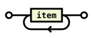

Consume one or more items using the lower return path.

```swift
let node = RailroadRepeat(inner: nt("item"), repeat: RailroadEmpty())
```

#### `zero-or-more`


Skip all items via the upper bypass, or consume one or more via the lower loop.

```swift
let node = RailroadOptional(inner: RailroadRepeat(inner: nt("item"), repeat: RailroadEmpty()))
```

#### `separated-list`

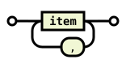

Consume one or more comma-separated items, without a leading or trailing comma.

```swift
let node = RailroadRepeat(inner: nt("item"), repeat: t(","))
```

### Boxes and annotations

#### `labeled-box`

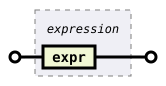

Draw a box around a node, with a label above it.

```swift
let node = RailroadLabeledBox(inner: nt("expr"), label: c("expression"))
```

#### `annotation`

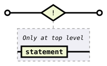

Connect a checkpoint to a labeled box below the path.

```swift
let node = RailroadAnnotation(inner: RailroadLabeledBox(
    inner: nt("statement"), label: c("Only at top level")))
```

#### `negative-lookahead`

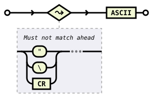

Consume one ASCII character if the upcoming input does not start with a quote, backslash, or CR. The assertion itself consumes no input.

```swift
let node = RailroadSequence(children: [
    RailroadAnnotation.newAhead(inner: RailroadLabeledBox(
        inner: RailroadSequence(children: [
            RailroadChoice(children: [t("\""), t("\\"), nt("CR")]), RailroadContinuation()
        ]), label: c("Must not match ahead"))),
    nt("ASCII")
])
```

#### `negative-lookbehind`

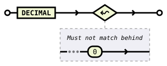

Match a decimal integer, then reject exactly `0`.

```swift
let node = RailroadSequence(children: [
    nt("DECIMAL"),
    RailroadAnnotation.newBehind(inner: RailroadLabeledBox(
        inner: RailroadSequence(children: [RailroadContinuation(), t("0")]),
        label: c("Must not match behind")))
])
```

#### `scale`


Enlarge the inline comment and shrink the return-path comment, keeping their connecting rails aligned.

```swift
let node = RailroadRepeat(
    inner: RailroadScale(inner: c("Scaled up"), scale: 1.5),
    repeat: RailroadScale(inner: c("Scaled down"), scale: 0.75))
```

### Start, end and continuation

#### `start-end`


Vertical bars mark the beginning and end of a complete diagram.

```swift
let node = RailroadSequence(children: [RailroadStart(), nt("expr"), RailroadEnd()])
```

#### `simple-start-end`


Circles provide compact start and end markers.

```swift
let node = RailroadSequence(children: [RailroadSimpleStart(), nt("expr"), RailroadSimpleEnd()])
```

#### `continuation`


An ellipsis marks an omitted section.

```swift
let node = RailroadSequence(children: [t("BEGIN"), RailroadContinuation(), t("END")])
```

#### `continuation-start-end`


Three dots mark omitted portions before and after the fragment.

```swift
let node = RailroadSequence(children: [
    RailroadContinuationStart(), nt("expr"), RailroadContinuationEnd()
])
```

### Layout

#### `vertical-grid`

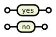

Place independent diagrams above one another, with no connecting path.

```swift
let node = RailroadVerticalGrid(children: [
    RailroadSequence(children: [RailroadSimpleStart(), t("yes"), RailroadSimpleEnd()]),
    RailroadSequence(children: [RailroadSimpleStart(), t("no"), RailroadSimpleEnd()])
])
```

#### `horizontal-grid`


Place the same independent diagrams beside one another.

```swift
let node = RailroadHorizontalGrid(children: [
    RailroadSequence(children: [RailroadSimpleStart(), t("yes"), RailroadSimpleEnd()]),
    RailroadSequence(children: [RailroadSimpleStart(), t("no"), RailroadSimpleEnd()])
])
```

#### `alignment`

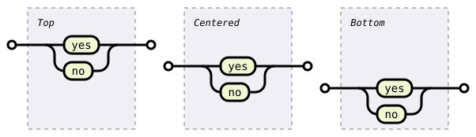

Place a choice at the top, center, or bottom of equal-height boxes. The choice keeps its natural size, and its connecting rail moves with it.

```swift
let placements: [(RailroadVerticalAlignment, String)] = [(.top, "Top"), (.centered, "Centered"), (.bottom, "Bottom")]
let rows: [any RailroadNode] = placements.map { vertical, label in
    RailroadSequence(children: [RailroadSimpleStart(),
        RailroadLabeledBox(inner: RailroadAlignment(
            inner: RailroadChoice(children: [t("yes"), t("no")]), minWidth: 120, minHeight: 110,
            horizontal: .centered, vertical: vertical, connectRails: true), label: c(label)),
        RailroadSimpleEnd()
    ])
}
let node = RailroadHorizontalGrid(children: rows)
```

#### `aligned-rule-labels`

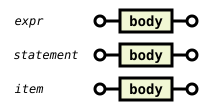

Reserve equal widths for rule labels so each diagram body begins at the same horizontal position.

```swift
let labels = ["expr", "statement", "item"].map(c)
let columnWidth = labels.map(\.width).max()!
let rows = labels.map { label in
    RailroadHorizontalGrid(children: [
        RailroadAlignment(inner: label, minWidth: columnWidth, minHeight: 0,
                          horizontal: .start, vertical: .top, connectRails: false),
        RailroadSequence(children: [RailroadSimpleStart(), nt("body"), RailroadSimpleEnd()])
    ])
}
let node = RailroadVerticalGrid(children: rows)
```

<!-- guide:end -->

## Themes

`light`, `dark`, `rust`, `coal`, `navy`, `ayu`, plus `lightRendersafe` and
`darkRendersafe` for SVG renderers with limited CSS support. The CSS is copied
unchanged from the Rust crate.

## PNG export (macOS)

The separate `RailroadImage` product renders a diagram through WebKit, so the
core `Railroad` library needs nothing but Foundation:

```swift
import RailroadImage

let png = try await RailroadImage.png(diagram, scale: 2)   // Data
let image = try await RailroadImage.image(diagram)         // NSImage
```

## Tests

`swift test` runs the ported upstream unit tests, plus byte-for-byte comparisons
against reference SVGs made by the Rust crate:

- the 27 diagrams of the crate's own visual vocabulary,
- 20 `railroad_dsl` examples,
- 40 diagrams generated from real regular expressions by iTerm2.

## License

MIT, see [LICENSE](LICENSE). Original work © 2018 Lukas Lueg. Swift port © 2026
Veridit AS.

`RailroadWidthTable.swift` is generated from the
[unicode-width](https://github.com/unicode-rs/unicode-width) crate 0.2.3,
© 2015 The Rust Project Developers, MIT License.

## Thanks

George Nachman (iTerm2) reviewed the port and ran a differential fuzz of about
115,000 inputs against the Rust original. His fixes are in 0.1.1: cached
geometry (layout was exponential in nesting depth), exact unicode-rs column
widths, per-code-point XML escaping, and rejection of leading whitespace as pest
does. See [iTerm2 9d2236a6](https://github.com/gnachman/iTerm2/commit/9d2236a6).
